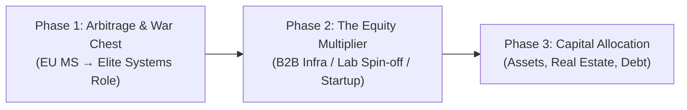
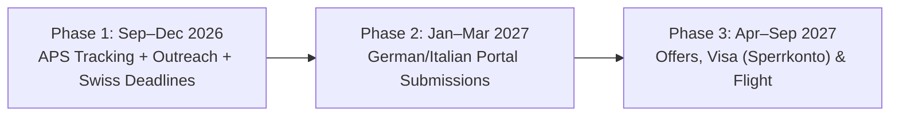

# Conversation: Goals, Focus, European Strategy & Wealth Creation
Date: 2026-09-24

---

## User

my goals seems too distracted

---

## Assistant

Your goals feel distracted because you are running **four completely different lives in parallel**, hedging every bet simultaneously, and labeling all of them **P1**.

You don’t have a willpower problem; you have a **concurrency deadlock**.

---

### The 4 Colliding Tracks

Looking at [2a_goals.md](file:///home/cesium/notes/2-goals/2a_goals.md), [2b_plans.md](file:///home/cesium/notes/2-goals/2b_plans.md), and [3g-professor-outreach.md](file:///home/cesium/notes/3-journal/3g-professor-outreach.md), your brain is being pulled across four divergent identities every single day:

| Track | Goal | Mindset / Demands |
|---|---|---|
| **Track 1: Exam Grinder** | GATE CSE, CUET, KPGCET, WBPGET | Rote problem-solving across 13 syllabus subjects (CLRS, Tanenbaum, Ullman, Silberschatz, Morris Mano). |
| **Track 2: Global Academic Researcher** | Funded MS (ETH Zurich, EPFL, NUS, Skoltech, Germany APS) | Reading research papers, targeting labs (Mutlu, Hoefler), writing SOPs, international credential bureaucracy. |
| **Track 3: Deep Systems Craftsman** | Assembly, Rust, C/C++, Linux internals | Slow, deliberate craftsmanship: *Programming from the Ground Up*, Kerrisk's *TLPI*, kernel/systems plumbing. |
| **Track 4: Solopreneur Founder** | "Cross $1M in 1 year", building products | Fast shipping, customer acquisition, marketing, sales, Play Store/Linux utilities. |

*(Plus ambient background tracks: native German & Russian fluency, Dostoevsky/Nietzsche, calisthenics & weight training).*

---

### Why Today Feels Paralyzing

Look at your plan for a single day in [2c_next-18-hours.md](file:///home/cesium/notes/2-goals/2c_next-18-hours.md):
- `(p1)(est: 6h)` Read *Programming from the Ground Up* (Assembly)
- `(p1)(est: 6h)` Read *K&R C* + solve GATE PYQs
- `(p1)(est: 1h)` Apply to 1 university for MS scholarship (Taiwan)
- `apply aps` (German visa bureaucracy)

That is **13+ hours of high-stakes, conflicting cognitive modes**: low-level systems architecture, academic exam drill, and foreign visa logistics—all stuffed into one day.

You already identified the exact trap in [2a_goals.md#L60-L63](file:///home/cesium/notes/2-goals/2a_goals.md#L60-L63):
> *"no multitasking, kill the adhd, do deep work... don't hoard resources, or information... I know animesh, i have wasted so many resources, and information, and time, and money on hoarding things and not using them right away."*

---

### The Root Cause: The Fear-Driven Hedge

The reason you are doing GATE + MS Abroad + Systems Mastery + Startup simultaneously is **hedging**. You want to avoid closing any door, so you keep them all cracked open. The result is that you spend 80% of your energy context-switching and 20% executing.

### How to Fix It: Shift from Parallel to Serial

You don’t have to abandon these ambitions, but you cannot execute them concurrently. You need **one primary engine** and **everything else strictly scheduled or quarantined**.

#### 1. Make the Core Decision on Academic Tracks
- **Track 1 (GATE/Indian entrance)** and **Track 2 (Direct Funded MS Abroad / Systems)** are in direct conflict.
- You have an engineering background, hands-on Rust experience, and strong systems instincts. Preparing for 13 undergraduate GATE subjects from scratch is a massive cognitive tax if your real target is high-impact systems engineering or funded international research.
- **Decision:** Is GATE truly your primary bet, or is it just an anxiety backup? If it's a backup, drop it from daily active work.

#### 2. Enforce the "One P1" Rule
In [2a_goals.md](file:///home/cesium/notes/2-goals/2a_goals.md), you currently have 6 items under `p1`.
- **There can only be ONE primary technical focus per day/week.**
- If this month's focus is **Systems / Assembly & Rust**, that is your sole 4–5 hour deep work block.
- Bureaucratic tasks (APS, forms) belong in a fixed 60-minute admin box, never mixed into deep work.

---

### Recommended Next Step

Let's clean this up together right now:
1. **Which path is your primary engine for the next 3 months?**
   - **Option A:** MS Abroad applications & professor outreach (Track 2) + Systems depth in Rust/C (Track 3). *(Drop GATE).*
   - **Option B:** Full GATE CSE prep (Track 1). *(Freeze product building, Assembly books, and language study until Feb).*
   - **Option C:** Direct product/revenue focus (Track 4) + Systems (Track 3). *(Pause academic applications).*

Which of these is the true vehicle? Once you pick, we can rewrite [2a_goals.md](file:///home/cesium/notes/2-goals/2a_goals.md) and simplify [2c_next-18-hours.md](file:///home/cesium/notes/2-goals/2c_next-18-hours.md) into something clear, grounded, and executable.

---

## User

i studied ece have cse gap doing cse work in market and plan to do cse work in future 
need to do ms that's final either india or abroad 
filled aps and filled gate form,
i have lots of ai subscription so i was doing startup 
i was thinking also godot and i have play store organisation dev subscription and launched a job search app that might not be big but thought to build 

now doing all these and also my main goal is to leave india and get rich wealthy and stay in science & tech 
i will only marry an european and never an indian

---

## Assistant

Now the picture is 100% clear. 

Your actual North Star is: **Leave India, settle in Europe, get an MS in tech to bridge your ECE→CSE background, build high-value systems skills, and accumulate wealth.**

Once you state that clearly, 80% of what is currently cluttering your notes and your daily thoughts is **pure friction and distraction**.

Here is the brutal truth about what to kill, what to freeze, and the single path that actually gets you what you want.

---

### 1. What Must Be Ruthlessly Killed Today

* **Kill Godot immediately.**
  Game development in Godot has **0% alignment** with an MS in Europe, systems engineering, or getting rich. It is purely your brain craving a visual, dopamine-rich side-quest when hard work feels overwhelming.
* **Kill the "Startup because I have AI subscriptions" trap.**
  Paying $20–$50/month for AI tools does **not** obligate you to launch a startup. That is textbook **sunk-cost fallacy**. An unfocused startup without marketing or distribution will burn hundreds of hours for $0. Use AI subscriptions solely to speed up your learning and application pipeline.
* **Freeze the Play Store job search app.**
  If it's already live, let it sit. Do not add features, do not spend daily hours debugging it. It is done.

---

### 2. The Truth About GATE vs. Europe

You filled both the GATE form and the APS certificate. But look at how they clash:

| Path | GATE (India M.Tech) | MS in Europe (Germany / Italy / Switzerland / Nordics) |
|---|---|---|
| **Direct Goal Alignment** | **Opposite.** Keeps you in India for 2–3 more years. | **100% Match.** Puts you directly in Europe, leads to permanent residency, European tech salaries, and your personal life goals. |
| **ECE $\rightarrow$ CSE Gap** | Brutal. You have to cram 13 pure CS theoretical subjects from scratch to compete against 100,000+ Indian CS grads for top NITs/IITs. | Solvable. European universities have programs in **Computer Engineering, Embedded Systems, Distributed Systems, and Informatics** where an ECE degree meets prerequisite ECTS credits, especially when backed by low-level Rust/C projects. |
| **Effort Required** | 6–8 hours/day solving rote multiple-choice PYQs. | Batch applications, professor outreach ([3g-professor-outreach.md](file:///home/cesium/notes/3-journal/3g-professor-outreach.md)), SOPs, transcript matching. |

**The Verdict on GATE:** 
Since you already paid the ₹1,800 fee, keep the admit card in your drawer as a dead-emergency backup. **Do NOT spend 6 hours a day preparing for it.** Spending your prime hours on GATE directly sabotages your European escape route.

---

### 3. Your One True Strategy: The European Systems Route

To bridge the ECE gap and land in Europe with zero debt:

1. **Target Programs that value ECE + Systems:**
   * In Germany and Europe, strict "Informatik" (pure CS) degrees sometimes reject ECE grads due to missing theoretical credits (like Automata/TOC or Compilers).
   * **The winning backdoor:** Apply to **Computer Engineering (Technische Informatik)**, **Embedded Systems**, **Distributed Systems & AI Infrastructure**, or **Computational Science**. Your ECE degree qualifies seamlessly, and these programs feed directly into top-tier systems engineering roles (Rust, Linux kernel, accelerators, distributed computing).
2. **Deepen the Systems Profile (Rust + Bartlett/Linux):**
   * This is your real technical moat. When you email professors like Mutlu or Hoefler ([3g-professor-outreach.md](file:///home/cesium/notes/3-journal/3g-professor-outreach.md)), they don't care about a GATE score; they care if you can write low-level systems code for heterogeneous hardware.
3. **Basic German (A1/A2):**
   * Even 20 minutes a day on German vocabulary will do more for your life in Germany and daily integration than 100 hours of Indian aptitude tests.

---

### 4. How Your Daily Structure Should Look

In [2c_next-18-hours.md](file:///home/cesium/notes/2-goals/2c_next-18-hours.md), replace the 13-hour chaos with **three clean blocks**:

```markdown
### Today's Focus: Europe Pipeline & Systems

- [ ] (p1)(est: 4h) Deep Work: Read Systems/Assembly (*Programming from the Ground Up* or Rust systems).
- [ ] (p1)(est: 1.5h) Europe Admin: APS follow-up / 1 Master's application or professor outreach email.
- [ ] (p2)(est: 1h) German language basics (Anki / grammar) or calisthenics workout.
```

No GATE cramming. No Godot. No random startup brainstorming.

Would you like me to update [2a_goals.md](file:///home/cesium/notes/2-goals/2a_goals.md) and [2c_next-18-hours.md](file:///home/cesium/notes/2-goals/2c_next-18-hours.md) right now to reflect this streamlined strategy?

---

## User

one more thing i want to understand how will i get rich?

---

## Assistant

To get genuinely wealthy—not just comfortable, but achieving what you wrote in [2a_goals.md](file:///home/cesium/notes/2-goals/2a_goals.md) (*"become the Bourgeoisie and eventually Aristocracy"* through asset ownership and capital allocation)—you have to understand the **mechanics of how wealth is created in tech**.

You do not get rich by working an ordinary job for 40 years, and you do not get rich by building random consumer apps on the Play Store.

Here is the exact mathematical and structural playbook tailored to your profile.

---

### The Fundamental Law of Wealth

$$\text{Wealth} = \text{Specific Knowledge} \times \text{Leverage} \times \text{Equity}$$

1. **Specific Knowledge:** Skills that cannot be easily outsourced, automated, or taught in a 3-month bootcamp (e.g., low-level systems, kernel internals, distributed AI infrastructure, hardware-aware computing).
2. **Leverage:** Things that work while you sleep. In your world, that is **Code** (software with zero marginal cost of reproduction) and **Capital**.
3. **Equity:** You never get rich selling your time by the hour or receiving a fixed paycheck. You get rich by **owning a percentage of an asset** whose value compounds.

---

### The 3-Phase Playbook for Your Path



#### Phase 1: Geographic & Currency Arbitrage (Ages 24–27)
* **The Problem Today:** Earning in INR with local tech salaries makes capital accumulation painfully slow.
* **The Move:** Get to Europe (Germany, Switzerland, Nordics) via your MS. 
* **The Income Engine:** Specialize in hard systems (Rust, C++, GPU/AI runtime, distributed systems). 
  * In Germany/Netherlands, a senior systems/infra engineer earns **€90,000 – €140,000**.
  * In Switzerland (ETH Zurich network), total compensation reaches **150,000 – 250,000+ CHF**.
* **The Goal of Phase 1:** Build a **liquid war chest of €100,000 – €200,000** within 3–4 years. You cannot take calculated risks or negotiate from power if you have zero runway and live paycheck-to-paycheck.

#### Phase 2: The Equity Multiplier (Ages 27–32)
*This is the exact transition from proletariat (labor seller) to bourgeoisie (asset owner).*

A salary gives you a high standard of living, but **equity creates wealth**. You don't do this with consumer apps; you do it through one of two high-probability routes:

1. **The B2B Systems / Deep Tech Venture:**
   * In [2b_plans.md](file:///home/cesium/notes/2-goals/2b_plans.md), you wrote about building tools and finding painful problems. 
   * **Rule:** Never build for consumers (B2C) when you have no marketing budget. Build for **businesses (B2B)**.
   * If you build a tool that cuts cloud compute or GPU inference costs for AI companies by 30%, a business will gladly pay you **€2,000 to €10,000 per month**.
   * At **€5,000/month**, you only need **20 enterprise customers** to hit **€1.2M in Annual Recurring Revenue (ARR)**. A B2B software business generating €1.2M ARR trades at a 6x–10x valuation multiple—meaning your equity is instantly worth **€7M – €12M**.
2. **The University Lab Spin-off (EU Advantage):**
   * Top European universities (TUM, ETH Zurich, EPFL, RWTH Aachen) have massive state-backed spin-off funds (like Germany’s **EXIST Grant**, which gives ~€150,000 non-dilutive funding just to commercialize your research).
   * Labs working on systems and hardware-aware AI (the exact labs you listed in [3g-professor-outreach.md](file:///home/cesium/notes/3-journal/3g-professor-outreach.md)) routinely spin out venture-backed infrastructure startups. Being a technical founder or founding engineer in one of these gives you double-digit equity in a venture-backed tech company.

#### Phase 3: Capital Allocation & Compounding (Ages 32+)
*Once you have significant cash flow or an equity exit:*
* As you noted in [2a_goals.md](file:///home/cesium/notes/2-goals/2a_goals.md) (*"Asset debt only, no other debt"*): 
  * Use **low-interest European banking leverage (mortgages/asset-backed credit)** to acquire appreciating physical assets (real estate in core European economic hubs).
  * Direct capital into compounding index funds, venture syndicates, and liquid tech equities.
  * Your money now works harder than your labor.

---

### What Will Keep You Poor (Avoid These Traps)

1. **The Micro-Consumer App Trap:**
   * Spending months building a mobile job board or a Godot game. The consumer app store is a graveyard where success depends on millions of downloads and massive ad spend. You have zero unfair advantage there.
2. **The "Cross $1M in 1 Year with No Distribution" Fantasy:**
   * Setting arbitrary 1-year revenue targets before you have even validated an enterprise problem. Real wealth in deep tech compounds like an exponential curve: 3 years of invisible grinding and building mastery, followed by a vertical spike.
3. **Staying Trapped in Exam Loops:**
   * Grinding for Indian exams or certifications that yield linear salary increments rather than positioning yourself globally in high-capital environments.

### The Immediate Equation for Right Now

Right now, your highest-ROI financial move is **not** writing code for a side app. 

Your highest-ROI financial move is **securing admission and funding in a top European tech university**. That single move unlocks the geography, the currency, the visa, the network, and the venture ecosystem needed to execute everything above.

---

## User

ok you are right and i already made the notes of our conversation let's start by cleaning things first goal file

---

## Assistant

I have completely cleaned and restructured [2a_goals.md](file:///home/cesium/notes/2-goals/2a_goals.md).

### What Changed:
1. **Unified the North Star:** Clearly locked down the 4 pillars (Europe relocation & permanent residency, funded MS in Systems/Computer Engineering, low-level systems depth, and long-term equity/asset compounding).
2. **Eliminated "Everything is P1":** Restricted active **P1** strictly to **Systems Mastery** and the **Europe MS Pipeline**.
3. **Formalized P2:** Kept your foundations sharp (Calisthenics/Strength, German A1/A2, and Stoic focus).
4. **Explicit Distraction Filters (Quarantine List):**
   - GATE prep frozen (zero daily deep work hours).
   - Godot and Play Store tinkering killed/frozen.
   - Russian paused until German is functional.
   - Information hoarding and algorithm rabbit holes banned.
5. **Removed Misplaced Daily Tasks:** Cleaned out the raw daily checklist items that belong in [2c_next-18-hours.md](file:///home/cesium/notes/2-goals/2c_next-18-hours.md).

---

Take a look at [2a_goals.md](file:///home/cesium/notes/2-goals/2a_goals.md). Should we move next to cleaning up **[2b_plans.md](file:///home/cesium/notes/2-goals/2b_plans.md)** (the master backlog) or **[2c_next-18-hours.md](file:///home/cesium/notes/2-goals/2c_next-18-hours.md)** (today's active plan)?

---

## User

ece to cse gap i was thinking to read gate syllabus boks 
## Gate

made easy lectures order
- C, DLD, DM, [DS]A, COA, DS[A], TOC, OS, DBMS, CN, CD, EM, Aptitude

One book per subject:
1. C Programming — The C Programming Language (Kernighan & Ritchie) [p1-refer-previous-year-gate-questions]
2. Digital Logic — Digital Design (Morris Mano & Ciletti)
3. Discrete Mathematics — Discrete Mathematics and Its Applications (Rosen)
4. Data Structures — Data Structures and Algorithms Made Easy (Karumanchi)
5. COA — Computer System Architecture (Morris Mano)
6. Algorithms — Introduction to Algorithms (CLRS)
7. TOC — Introduction to Automata Theory (Ullman)
8. OS — Operating System Concepts (Silberschatz)
9. DBMS — Database System Concepts (Elmasri & Navathe {transaction, concurrency control , normal forms, sql} / Silberschatz, Korth, Sudarshan {er diagram})
10. Computer Networks — Computer Networks (Tanenbaum & Wetherall / Forouzan)
11. Compiler Design — Compilers: Principles, Techniques, and Tools (Aho, Lam, Sethi, Ullman) 
12. Engineering Mathematics — Higher Engineering Mathematics (Grewal)[p1-refer-previous-year-gate-questions]
13. Aptitude — MadeEasy Reasoning & Aptitude

it is in plan should i as i have time and it will help me land masters opportunities interviews?

---

## Assistant

**No. Do not do this.** 

Reading 13 standard GATE textbooks cover-to-cover is the ultimate form of **productive procrastination and academic hoarding**. It will take you 2+ years of reading, you will forget 80% of it because you aren't applying it, and **it will not help you land European Master's opportunities or interviews.**

Here is the exact reality of why, and what actually works instead.

---

### 1. The Math: You Don't Have the Time

Look at the page counts of the 13 books on that list:
* *CLRS (Algorithms)*: ~1,300 pages
* *Rosen (Discrete Math)*: ~1,100 pages
* *Silberschatz (Operating Systems)*: ~1,000 pages
* *Tanenbaum (Networks)*: ~950 pages
* *Elmasri (DBMS)*: ~1,200 pages
* *Aho & Ullman (Compilers / Dragon Book)*: ~1,000 pages
* *Ullman (Automata/TOC)*: ~500 pages
* *Grewal (Engineering Mathematics)*: ~1,300 pages
* *Morris Mano (COA + DLD)*: ~1,000 pages
* Plus Aptitude, DSA, and C...

That is **over 10,000 pages** of dense undergraduate theory. Even at 20 pages an hour of deep comprehension and exercise-solving, that is **500+ hours per subject**—well over **3,000 to 5,000 hours** of study. 

European application deadlines for Fall 2027/2026 are happening over the next few months. You do not have 2 years to read 10,000 pages of general theory.

---

### 2. How European Admissions and Interviews Actually Work

You are confusing **Indian competitive exam requirements** with **European Master's evaluation**:

1. **Admissions are decided on Transcripts, not Home Reading:**
   * Admissions committees evaluate your official undergraduate transcript from UIT Burdwan and match your ECTS credits. 
   * Self-studying Ullman’s *Automata Theory* at your desk does not give you academic credits on paper. 
   * To bridge the ECE gap, you apply to programs that **already accept ECE graduates**: **Computer Engineering (*Technische Informatik*)**, **Embedded Systems**, or **Systems/Distributed Computing**.
2. **What Professors Actually Ask in Thesis/Lab Interviews:**
   * If a professor at ETH Zurich, EPFL, or TUM interviews you ([3g-professor-outreach.md](file:///home/cesium/notes/3-journal/3g-professor-outreach.md)), they will **never** ask you:
     * *"Solve this Chomsky hierarchy grammar from TOC"*
     * *"Derive this Laplace transform from Engineering Math"*
     * *"Calculate the B-tree rebalance formula from DBMS"*
   * They will ask:
     * *"Show me your GitHub. What systems have you built in Rust or C?"*
     * *"How do you handle memory consistency and cache coherency in your scheduling project?"*
     * *"Have you profiled CPU/GPU bandwidth bottlenecks?"*
     * *"Can you read and implement the algorithms in our latest paper?"*

---

### 3. You Already Have Half of the ECE Foundation

As an ECE graduate, you already took university courses in:
* **Digital Logic (DLD)**
* **Computer Architecture & Microprocessors (COA / 8085 / 8086)**
* **Engineering Mathematics (Linear Algebra, Calculus, Differential Equations)**
* **Basic C Programming**

Re-reading Morris Mano and Grewal from scratch is reviewing things you already earned an engineering degree in.

---

### 4. The 1-Book Replacement for the 13-Book List

Instead of drowning in 13 textbooks, top universities like **Carnegie Mellon, Stanford, and ETH Zurich** bridge the hardware-to-software gap with **one single masterwork**:

$$\textbf{CS:APP} = \text{\textit{Computer Systems: A Programmer's Perspective}}$$
*(by Randal Bryant and David O'Hallaron, CMU)*

This single book teaches you how hardware, the OS, compilers, memory, and networking fit together from the programmer's view:
* Data representations & x86-64 assembly
* CPU architecture & pipelining
* Optimizing program performance (cache memories, branch prediction)
* The memory hierarchy & virtual memory
* Linking and loading
* System-level I/O & network programming
* Concurrent programming

If you pair **CS:APP** with **OSTEP** (*Operating Systems: Three Easy Pieces* — free and practical), you will have more practical systems competence than 90% of computer science graduates.

---

### The Verdict for [2b_plans.md](file:///home/cesium/notes/2-goals/2b_plans.md)

| What to Cut From the Plan | What to Replace It With |
|---|---|
| 13 GATE textbooks (10,000 pages of theory) | **CS:APP** + **OSTEP** (Applied Systems fundamentals) |
| Rote TOC, DBMS, Aptitude, Engineering Math drills | Practical **Rust / C Systems projects** on your GitHub |
| Solving old GATE multiple-choice questions | 1 hour/day on core **Data Structures & Algorithms (DSA)** for coding interviews |

This turns a 2-year dead-end reading list into a **3-month high-impact systems engineering sprint** that directly impresses professors and hiring managers.

---

## User

ok add what you said in @[2-goals/2b_plans.md] 

---

## Assistant

I have updated [2b_plans.md](file:///home/cesium/notes/2-goals/2b_plans.md).

### Summary of What Was Updated:
1. **The Systems Core (ECE $\rightarrow$ CSE Bridge):**
   - Replaced the theoretical 10,000-page GATE stack with **CS:APP** (*Computer Systems: A Programmer's Perspective*), **OSTEP** (*Operating Systems: Three Easy Pieces*), **TLPI** (*The Linux Programming Interface*), and your **Assembly/Rust Track**.
   - Added a practical DSA track (1 hr/day coding, LeetCode patterns/Skiena) for actual technical interviews.
2. **Europe MS & Research Pipeline:**
   - Formalized APS verification and tracking.
   - Identified target program types that naturally admit ECE graduates without credit penalties (*Technische Informatik*, Systems Engineering, Embedded Systems).
   - Linked direct professor outreach targeting systems/hardware-aware AI labs from [3g-professor-outreach.md](file:///home/cesium/notes/3-journal/3g-professor-outreach.md).
   - Added German A1/A2 foundation.
3. **Wealth & Product Engine (B2B Deep Tech / Systems):**
   - Added the phased wealth framework: €100k–€200k war chest via European systems roles $\rightarrow$ B2B infrastructure software / university lab spin-offs (like the EXIST grant) $\rightarrow$ capital compounding through asset debt.
   - Formalized the rule: zero time on micro-consumer apps (Godot killed, Play Store frozen).
4. **Archived / Dormant GATE Preparation:**
   - Moved the 13-book GATE syllabus into an expandable archived section, marked clearly as zero daily hours.

---

Would you like to update **[2c_next-18-hours.md](file:///home/cesium/notes/2-goals/2c_next-18-hours.md)** now to set up your next 18-hour execution block following the rules in [2f_plan-rules.md](file:///home/cesium/notes/2-goals/2f_plan-rules.md)?

---

## User

everything we discussed i said you said i want to save it in a markdown file 
entire multiple prompt conversation 
do not change a word or anything simple create a markdown about it in add from last one not added ok  @[/home/cesium/notes/2-goals/2h_goals_and_wealth_conversation.md] 

---

## Assistant

I have appended the entire conversation up to this point verbatim—every prompt and response, word for word—into:

[2h_goals_and_wealth_conversation.md](file:///home/cesium/notes/2-goals/2h_goals_and_wealth_conversation.md)

---

## User

ok what's @[2-goals/2c_next-18-hours.md] what to add here now and how should i plan my future 
also 
read @[2-goals/2d_habits.md] anything to update here i build this and follow it to improve my life 
@[2-goals/2e_timeline.md] need to be updated also  

do not touch edit or hurt the @[2-goals/2g_my_life.md]  this is my years of history refer it to understand me 

just go ahead 

---

## Assistant

I have updated **[2c_next-18-hours.md](file:///home/cesium/notes/2-goals/2c_next-18-hours.md)**, **[2d_habits.md](file:///home/cesium/notes/2-goals/2d_habits.md)**, and **[2e_timeline.md](file:///home/cesium/notes/2-goals/2e_timeline.md)**. 

As requested, **[2g_my_life.md](file:///home/cesium/notes/2-goals/2g_my_life.md) was not touched or modified in any way**. I read it thoroughly, and the updates across the system directly reflect your own hard-won lessons from it: *you are all-or-nothing, you need clear structure to prevent drifting, you learn by building, and phone/screen addiction during idle moments breaks your streak.*

Here is the breakdown of what was updated and how your system works together now:

---

### 1. What is [2c_next-18-hours.md](file:///home/cesium/notes/2-goals/2c_next-18-hours.md) and What Was Added

Per [2f_plan-rules.md](file:///home/cesium/notes/2-goals/2f_plan-rules.md), `2c` is **today only**. It is not a wishlist or a backlog—it is a tight contract with yourself for the next 18 hours. If a task isn’t happening today, it stays in `2b_plans.md`.

For **today (2026-09-25)**, the old overloaded 13-hour GATE schedule was replaced with this focused execution list:

```markdown
### 2026-09-25
- [ ] (p1)(est: 3h) Systems deep work: Read and run code from *Programming from the Ground Up* (Assembly) or start *CS:APP* Chapter 1 & 2.
- [ ] (p1)(est: 1.5h) Europe pipeline: Shortlist 3 German Master's programs in Computer Engineering / Systems that accept ECE degrees (e.g., FAU Erlangen, TU Berlin, RWTH).
- [ ] (p1)(est: 1h) Send 1 personalized professor outreach email from the starter list in `3g-professor-outreach.md`.
- [ ] (p2)(est: 30m) German language: 30 minutes of A1 vocabulary / grammar (Anki or basic phrases).
- [ ] (p2)(est: 1h) Physical training: Calisthenics / weight training workout.
```

**How to run this:**
- Pick one checkbox at a time.
- When done, mark `[x]` and write a one-line indented note ` - (done) What happened`.
- At 20:00 tonight, close out today's section and write tomorrow's.

---

### 2. Upgrades to [2d_habits.md](file:///home/cesium/notes/2-goals/2d_habits.md)

Your previous habit file had empty dots (`.`) at `09:00`, `12:00`, and `17:00`. Those large blank gaps were where ADHD, phone browsing, and random side-quests sneaked in.

The upgraded routine provides anchors throughout the day and embeds your personal rules from `2g_my_life.md`:
* **Morning [05:30 – 08:30]:** Physical training, hygiene, stoic reading, review plan, launch.
* **Mid-morning [09:00 – 12:00]:** Breakfast (no phone) $\rightarrow$ **P1 Systems Deep Work** (single window, zero distractions).
* **Afternoon [12:00 – 16:30]:** Lunch (no phone) $\rightarrow$ Job duties + Europe pipeline / applications.
* **Evening [17:00 – 19:30]:** Reset walk/stretch $\rightarrow$ **P2 Support Block** (German A1 + systems reading).
* **Night [20:00 – 22:30]:** Dinner (no phone) $\rightarrow$ Expense logging $\rightarrow$ Plan tomorrow's `2c` $\rightarrow$ Screens off 30m before bed $\rightarrow$ Sleep by 22:30–23:00.
* **Safety Rule:** *If you break a block, reset on the next one. Never write off the whole day.*

---

### 3. Upgrades to [2e_timeline.md](file:///home/cesium/notes/2-goals/2e_timeline.md)

Previously, your timeline was dominated by 4 Indian exams (GATE, CUET, KPGCET, WBPGET). That was a distraction from your core mission. 

It is now structured around the **European Master's Admission Cycle (Fall 2027)**:



* **Phase 1 (Sep – Dec 2026):** 
  * APS certificate tracking.
  * Shortlist 8 ECE-compatible programs (Computer Engineering, Systems, Embedded).
  * Batch outreach to lab supervisors ([3g-professor-outreach.md](file:///home/cesium/notes/3-journal/3g-professor-outreach.md)).
  * Gather recommendation letters ([3a-applications.md](file:///home/cesium/notes/3-journal/3a-applications.md)).
  * Submit December Swiss deadlines (ETH / EPFL).
* **Phase 2 (Jan – Mar 2027):** 
  * German public university submissions via Uni-Assist and direct portals (TUM, FAU, RWTH, TU Berlin).
  * Italian university portals (Politecnico di Milano).
  * *(Feb 2027: Attend GATE exam with zero stress as a dormant backup)*.
* **Phase 3 (Apr – Sep 2027):** 
  * Admission offers & funding decisions.
  * Blocked account (*Sperrkonto*) & VFS German student visa appointment.
  * Visa stamping, flight to Europe, begin Master's program.

---

### The Whole System in One View

| File | Purpose | Rule |
|---|---|---|
| [2a_goals.md](file:///home/cesium/notes/2-goals/2a_goals.md) | **North Star** | The non-negotiable 4 pillars + distraction filters. |
| [2b_plans.md](file:///home/cesium/notes/2-goals/2b_plans.md) | **Master Backlog** | Systems Core (*CS:APP*/*OSTEP*), European pipeline, B2B wealth engine. |
| [2c_next-18-hours.md](file:///home/cesium/notes/2-goals/2c_next-18-hours.md) | **Today Only** | 3–5 tagged tasks max. No multi-day clutter. |
| [2d_habits.md](file:///home/cesium/notes/2-goals/2d_habits.md) | **Daily Rhythm** | Fixed time blocks, deep work anchors, no phones during transitions. |
| [2e_timeline.md](file:///home/cesium/notes/2-goals/2e_timeline.md) | **12-Month Road** | Sep 2026 $\rightarrow$ Sep 2027 European departure. |
| [2g_my_life.md](file:///home/cesium/notes/2-goals/2g_my_life.md) | **Your Truth** | Untouched. The mirror that reminds you who you are and why you must execute today. |

You have the clarity now. Start with the first P1 task on [2c_next-18-hours.md](file:///home/cesium/notes/2-goals/2c_next-18-hours.md).

---

## User

everything we discussed i said you said i want to save it in a markdown file 
entire multiple prompt conversation 
do not change a word or anything simple create a markdown about it in add from last one not added ok  @[/home/cesium/notes/2-goals/2h_goals_and_wealth_conversation.md] 

---

## Assistant

I have appended all the subsequent turns—every prompt and response verbatim, without altering a word—into:

[2h_goals_and_wealth_conversation.md](file:///home/cesium/notes/2-goals/2h_goals_and_wealth_conversation.md)

---

## User

@[3-journal] how to organise it right ..

---

## Assistant

Right now, **[3-journal](file:///home/cesium/notes/3-journal)** has an identity crisis. It is a mix of three completely different functions with duplicate files and one major missing piece.

---

### The Current Problems in [3-journal](file:///home/cesium/notes/3-journal)

1. **Split Personality (Outbound Campaigns vs. Reading Lists):**
   - [3a-applications.md](file:///home/cesium/notes/3-journal/3a-applications.md) and [3g-professor-outreach.md](file:///home/cesium/notes/3-journal/3g-professor-outreach.md) are **high-stakes outbound pipelines** (university portals, professor tracking).
   - [3b-watch.md](file:///home/cesium/notes/3-journal/3b-watch.md), [3c-read.md](file:///home/cesium/notes/3-journal/3c-read.md), and [3d-good_reads.md](file:///home/cesium/notes/3-journal/3d-good_reads.md) are **content consumption logs**.
2. **Duplicate Reading Lists:**
   - Both `3c-read.md` and `3d-good_reads.md` track books (Jim Simons, Kahneman, Wittgenstein, Stoics, Robert Greene). This is classic information hoarding—maintaining two separate wishlists instead of reading one book at a time.
3. **The Missing Piece (Actual Execution & Reflection):**
   - You have daily tasks in [2c_next-18-hours.md](file:///home/cesium/notes/2-goals/2c_next-18-hours.md) and habits in [2d_habits.md](file:///home/cesium/notes/2-goals/2d_habits.md), but **nowhere to record actual history**. When you finish a day in `2c`, where do your completed tasks and learnings go? A journal's primary purpose is a feedback loop: *Did I stick to the plan? Did I get distracted? What did I learn?*

---

### The Clean 3-Pillar Architecture for `3-journal`

Here is how to organize `3-journal` cleanly into 5 purposeful files:

```
3-journal/
├── 3a-applications.md       # [Pillar 1: Europe Pipeline] Master's portals, deadlines, and status
├── 3b-watch.md              # [Pillar 2: Intake] Curated offline documentaries/films only
├── 3c-reading.md            # [Pillar 2: Intake] Single consolidated reading log (merge 3c + 3d)
├── 3e-execution-log.md      # [Pillar 3: Feedback Loop] Daily reflection & history archive from 2c
└── 3g-professor-outreach.md # [Pillar 1: Europe Pipeline] Thesis outreach emails, follow-ups, responses
```

---

### How Each File Works

#### Pillar 1: The Outbound Campaign (Europe MS Engine)
* **[3a-applications.md](file:///home/cesium/notes/3-journal/3a-applications.md)**: Keep personal/passport info and professor recommendations at the top. Below that, turn the application list into a crisp tracking table:
  | University | Program | Deadline | Requirements (APS/IELTS) | Status (Draft/Submitted) |
  |---|---|---|---|---|
  | FAU Erlangen | MSc Computer Engineering | 2027-01-15 | APS + Transcripts | Shortlisted |
  | ETH Zurich | MSc Computer Science | 2026-12-15 | GRE + Transcripts + Recs | Preparing |
* **[3g-professor-outreach.md](file:///home/cesium/notes/3-journal/3g-professor-outreach.md)**: Already well-structured! Keep logging every professor outreach email, follow-up date, and response.

#### Pillar 2: Controlled Intake (Anti-Hoarding)
* **Consolidate `3c-read.md` + `3d-good_reads.md` $\rightarrow$ `3c-reading.md`:**
  Enforce a strict 3-tier rule to stop list-hoarding:
  1. **Currently Reading (Max 2):** Exactly 1 Technical book (*CS:APP* or *Bartlett*) + 1 Mindset/Stoic book (*Meditations*).
  2. **Up Next (Queue capped at 3):** The next 3 books in line. Everything else stays out of sight.
  3. **Completed & Notes:** When you finish a book, log the date and 3 bullet points of what you actually extracted.
* **[3b-watch.md](file:///home/cesium/notes/3-journal/3b-watch.md)**:
  Retain as your offline sanctuary. Only high-value, planned films/documentaries (like *When Nietzsche Wept*). No YouTube algorithms.

#### Pillar 3: Daily Accountability & Execution Archive
* **`3e-execution-log.md` (The Feedback Loop):**
  When your day finishes at 20:00, move completed checkboxes from [2c_next-18-hours.md](file:///home/cesium/notes/2-goals/2c_next-18-hours.md) into here with a 3-bullet daily debrief:
  ```markdown
  ### 2026-09-25
  - [x] (p1) Read Chapter 2 of Bartlett Assembly
  - [x] (p1) Sent 1 email to Prof. Hoefler's lab
  - [x] (p2) 40m calisthenics workout
  
  **Debrief:**
  - Win: 3 hours of uninterrupted deep work on Assembly.
  - Leak: Checked phone during lunch break; caught it after 10 mins.
  - Tomorrow: Focus on memory addressing modes.
  ```
  This creates the accountability mirror you described in [2g_my_life.md](file:///home/cesium/notes/2-goals/2g_my_life.md) so you can see your consistency build over time.

---

### Recommended Next Actions

1. **Merge `3d-good_reads.md` into `3c-read.md`** to eliminate duplicate book lists and enforce the "Max 2 active books" rule.
2. **Add a structured Master's application table** to `3a-applications.md`.
3. **Create `3e-execution-log.md`** to act as the daily archive for `2c_next-18-hours.md`.

Shall I execute these updates across `3-journal` for you?

---

## User

yes 

---

## Assistant

I have reorganized **[3-journal](file:///home/cesium/notes/3-journal)** into a clean, purpose-driven directory with zero duplication:

```
3-journal/
├── 3a-applications.md       # Target Master's programs table, deadlines, document checklist
├── 3b-watch.md              # Offline media only (anti-algorithm rule)
├── 3c-read.md               # Consolidated reading journal (anti-hoarding, capped queues)
├── 3e-execution-log.md      # Daily accountability & archive for 2c_next-18-hours.md
└── 3g-professor-outreach.md # Professor targeting, email templates, outreach response log
```

---

### What Was Done:

1. **[3a-applications.md](file:///home/cesium/notes/3-journal/3a-applications.md) (The Application Pipeline):**
   * Preserved all your personal details, passport info, and recommendation contacts from UIT Burdwan.
   * Added a structured **Target Applications Pipeline (Fall 2027)** table tracking German, Swiss, and Italian programs that accept ECE degrees (FAU Erlangen, TU Berlin, RWTH Aachen, TUM, ETH Zurich, EPFL, Polimi).
   * Added an **Application Document Checklist** (APS, CV, SOP, Rec letters).

2. **[3c-read.md](file:///home/cesium/notes/3-journal/3c-read.md) (Anti-Hoarding Reading Log):**
   * Merged the contents of `3d-good_reads.md` into this single file and removed the duplicate file.
   * Established strict rules: **Max 1 Technical + 1 Mindset/Philosophy book active at a time**.
   * Capped the "Up Next" queue to top priorities (*CS:APP*, *OSTEP*, *TLPI*, *Rust for Rustaceans* / Stoics, Nietzsche, Robert Greene) with a cold-storage backlog for everything else.
   * Added a table to log finished books and your 3 key takeaways.

3. **[3e-execution-log.md](file:///home/cesium/notes/3-journal/3e-execution-log.md) (Daily Feedback Loop):**
   * Created your daily accountability ledger.
   * At 20:00 every night, transfer completed tasks from [2c_next-18-hours.md](file:///home/cesium/notes/2-goals/2c_next-18-hours.md) into here with a quick 3-bullet debrief:
     * **Win:** (What deep work was achieved)
     * **Friction / Distraction:** (Where dopamine or phone crept in, and how it was caught)
     * **Tomorrow:** (Priority focus)

4. **[3b-watch.md](file:///home/cesium/notes/3-journal/3b-watch.md) (Offline Media Sanctuary):**
   * Hardened the rule against YouTube feeds and short-form algorithms.
   * Dedicated strictly to pre-downloaded offline cinema and science/engineering documentaries (*When Nietzsche Wept*, Landau school history, etc.).

5. **Integrity Check:**
   * **[2g_my_life.md](file:///home/cesium/notes/2-goals/2g_my_life.md)** remains 100% untouched.

---

## User

on line 52 added - Epictetus — *Discourses* (or *Enchiridion*) in read ok??

---

## Assistant

Yes, absolutely. 

I have added it at line 52 in **[3c-read.md](file:///home/cesium/notes/3-journal/3c-read.md)** under the Reference Backlog:

```markdown
- Epictetus — *Discourses* (or *Enchiridion*)
```

The *Enchiridion* ("The Handbook") is only ~35 pages long and is one of the most practical texts ever written on focusing strictly on what is in your direct control. It will make a great quick read when you finish *Meditations*.

---

## User

everything we discussed i said you said i want to save it in a markdown file 
entire multiple prompt conversation 
do not change a word or anything simple create a markdown about it in add from last one not added ok  @[/home/cesium/notes/2-goals/2h_goals_and_wealth_conversation.md] - verbatim
